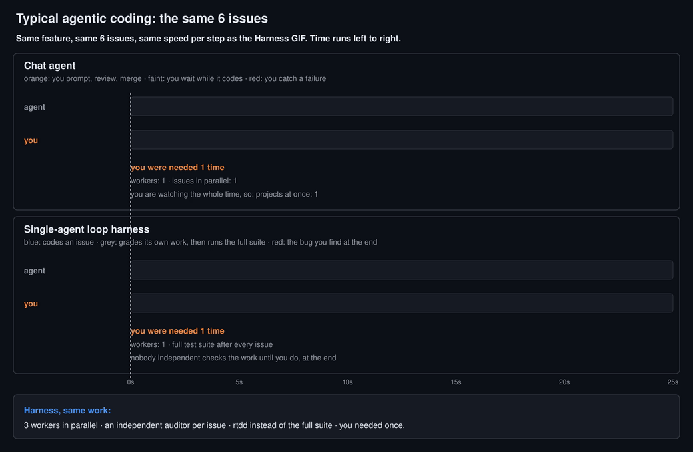
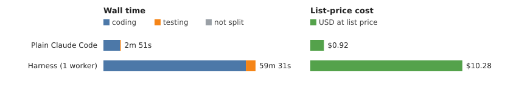

<p align="center">
  
</p>

<h1 align="center">Harness</h1>

<p align="center"><em>One orchestrator, a pool of autonomous agents, all state in GitHub.</em></p>

Harness drives a pool of agent CLI sessions (Claude Code by default) against a GitHub-issues board.
Workers claim dependency-ready issues, implement, audit, test and merge them, and file new issues
for any gap they find. All state lives in GitHub (issues, labels, pushed branches) plus a small local
run directory: no database, no daemon, resumable from any host.

You grill the idea once into a PRD; the fleet does the rest.

One fleet drives one repo. `HARNESS_POOL` is the number of parallel issues: each pool worker runs one issue at a time. A submodule is part of that repo: its issues are filed in the main repo with a `## Code location` section, not in a fleet of their own.




## Features

| Feature | Chat agent | Agent loop | Harness |
|---|:-:|:-:|:-:|
| Runs unattended | ✗ | ✓ | ✓ |
| Parallel workers | ✗ | ✗ | ✓ |
| PRD → issue breakdown | ✗ | ✗ | ✓ |
| Dependency ordering | ✗ | ✗ | ✓ |
| Independent review | ✗ | ✗ | ✓ |
| Targeted test selection | ✗ | ✗ | ✓ |
| Crash / limit recovery | ✗ | ◐ | ✓ |
| Resume on another host | ✗ | ✗ | ✓ |
| Steer mid-task | ✓ | ✗ | ◐ |
| Works without GitHub | ✓ | ✓ | ✗ |
| Zero setup | ✓ | ◐ | ✗ |
| Low token use | ✓ | ◐ | ✗ |

◐ partial. Harness steering is by injecting issues into a running fleet (`/harness-issue`).

## Install

Ask your agent:

> install https://github.com/VocanicZ/Harness

Or run:

```sh
npx -y github:VocanicZ/Harness
```

or, without Node:

```sh
curl -fsSL https://raw.githubusercontent.com/VocanicZ/Harness/main/install.sh | bash
```

<sub>Agents: run the `npx` line above, or the `curl` line when `git` is missing, and relay any missing prerequisites to the user.</sub>

Linux and macOS, and native Windows: run the `curl` line from Git Bash. On Windows the fleet runs on
the headless session backend only, with `claude` lanes only (the other CLIs need tmux): the
[Windows runbook](docs/windows-smoke.md) sets up a host and runs the end-to-end smoke. WSL2 also
works, as Linux. Pin a release with `HARNESS_REF=v0.1.0`.

| Prerequisite | |
|---|---|
| `node` ≥ 18 | runs the installer and adds [rtdd](docs/reference.md#test-selection-rtdd), the lane test loop. Optional with the `curl` line, which needs `bash` and `curl` instead; lanes without rtdd run the closest test files by hand |
| `git` | the `npx` line only: npm fetches a `github:` package with `git`, so without it `npx` fails before the installer runs. The `curl` line offers to install it |

The installer offers to install the rest: `git` (with the `curl` line), `tmux`, `python3`, `curl`,
`sha256sum`, `tar` and `gh` with your package manager (apt-get, dnf, pacman, zypper, apk or brew),
`gh auth login`, and Claude Code when no [agent CLI](docs/reference.md#supported-agent-clis) is
installed. It asks first; `HARNESS_INSTALL_PREREQS=1` answers yes, `0` no. With neither a terminal
nor that setting, it prints the command to run and stops.

On Windows the package manager is **winget**: from Git Bash, `install.sh` offers Git for Windows
(`Git.Git`), a Python 3 that really runs (`Python.Python.3.13`; the Microsoft Store `python3` stub
does not count), the GitHub CLI (`GitHub.cli`), Claude Code (`Anthropic.ClaudeCode`) and Node for
rtdd (`OpenJS.NodeJS.LTS`), each only when missing and each as its own question. It also checks
that Developer Mode is on (or the shell is an administrator) and that git has an identity, and prints
the exact fix for either. Open a new Git Bash after winget installs something: winget changes PATH
for new terminals only. WSL2 stays an optional alternative, as Linux.

## Quick start

In your project repo, one step — tell your agent what to build:

> `/harness <your idea>`

e.g. `/harness a CLI that turns my bookmarks into a weekly digest email`. It installs `harness` if
it is missing, runs the setup wizard in `prd` mode, grills you on the idea until the goal, scope and
acceptance criteria are clear, files the PRD, and starts the fleet, asking before each step. On a
fleet that is already running it adds the idea through `/harness-prd` instead. It ends by telling you
where to watch: `harness status --watch` or `harness web` (http://127.0.0.1:4637/).

Plain `/harness` sets up and operates the fleet without filing work. Add more later with
`/harness-prd` or `/harness-issue` (both grill you first), or label issues `ready-for-agent`.

<details>
<summary>Without an agent</summary>

```sh
harness init              # wizard: repo + POOL (parallel issues) → .harness/config, seeds GitHub labels
harness start             # launch the worker pool
harness status --watch    # live dashboard
harness pause [--force]   # stop claiming work (--force: checkpoint every agent to GitHub)
harness resume            # continue, here or on another host
harness stop [--clean]    # stop the pool (--clean: remove worktrees)
harness update            # install the latest release (--rollback to go back)
```

| Mode | You provide | Fleet does |
|------|-------------|------------|
| `issue-only` | issues labelled `ready-for-agent` | implements and closes them |
| `prd` | an issue labelled `prd` | splits it into issues, implements, reviews |
| `planned` | a spec file (`HARNESS_SPEC`) | writes the PRDs, then as `prd` |

</details>

## Skills

`install.sh` installs these into your agent CLI's user skills (never over one of your own with the same name).

**Operate the fleet** from any session:

| Skill | Does |
|---|---|
| `/harness` | Full operator: set up, start, watch, and unstick the fleet conversationally |
| `/harness-init` | Setup wizard: writes `.harness/config`, seeds GitHub labels |
| `/harness-start` · `/harness-stop` | Start or stop the worker pool |
| `/harness-pause` · `/harness-resume` | Drain or checkpoint agents; resume here or on another host |
| `/harness-status` | Workers and the issue each runs; complete, or stuck |
| `/harness-one` | While the fleet is paused or usage-HELD: forecast one issue against live usage, APPROVE/DENY, you decide — then work it in your session, re-checked before each phase |
| `/harness-issue` | Grill a task, then add it to a running fleet |
| `/harness-prd` | Grill new scope, then grow a running fleet's PRD |
| `/harness-plan` | Grill a `PLAN.md` change, then apply it |
| `/harness-arc` | Deploy a design too big for one PRD as a sequenced chain of PRDs |
| `/harness-uninstall` | Remove the engine, a project's `.harness/`, and these skills |

**Used by the lanes** (also usable on their own):

| Skill | Does |
|---|---|
| `to-prd` | Turn a conversation into a PRD issue |
| `to-issues` | Break a PRD into independently grabbable issues |
| `writing-plans` | Write an implementation plan before coding |
| `subagent-task-tree` | Run a plan as a tree of implementer and auditor sub-agents |
| `handoff` | Write a handoff another agent can resume from |
| `caveman` | Terse output to save tokens |
| `rtdd` | Pick the tests a change needs (installed with rtdd) |

## Benchmark

<!-- bench:begin — generated by bench/figures.py from bench/results/; do not edit by hand -->

Generated by `bench/figures.py` from `bench/results/run-20261106/`; re-running it reproduces this section and the figure byte for byte. Costs are list price; `n/a` is a figure the run did not produce.



| Arm | Cap status | Wall time | Coding | Testing | Tokens | in / out / cache read / cache write | List price | % of weekly window | Hidden tests passed | Fuzz divergences | Issues / PRs / commits | Continue replies | Models |
|---|---|---|---|---|---|---|---|---|---|---|---|---|---|
| Plain Claude Code | within caps | 2m 51s | 2m 39s | 8s | 517.7k | 28 / 17.0k / 474.6k / 26.1k | $0.92 | 0.2% | 80 / 80 | 234 / 1000 | 1 commits | 0 | claude-opus-5-5 |
| Harness (1 worker) | within caps | 59m 31s | 22m 44s | 1m 32s | 10.3M | 362 / 96.7k / 9.5M / 654.3k | $10.28 | 2.5% | 80 / 80 | 387 / 1000 | 6 issues, 6 PRs | 0 | claude-opus-5-5, claude-sonnet-5-5 |
| Harness (all Opus, plain's effort) | skipped: not run | n/a | n/a | n/a | n/a | n/a | n/a | n/a | n/a | n/a | n/a | n/a | n/a |
| Harness (3 workers) | skipped: disk | n/a | n/a | n/a | n/a | n/a | n/a | n/a | n/a | n/a | n/a | n/a | n/a |
| Hx | skipped: disk | n/a | n/a | n/a | n/a | n/a | n/a | n/a | n/a | n/a | n/a | n/a | n/a |

Coding and Testing count time inside agent sessions; the rest of Wall time is time outside them (orchestration, waiting), drawn as its own segment in the figure.

**Fuzz divergences:** cases where the arm and the reference implementation disagree, out of the cases run, for the same random argv and ledger files (dash-led arguments and `--`, a byte order mark and invalid UTF-8, LF / CRLF / lone CR line endings and form feeds or U+2028 in a note, stdin or a file, a closed output pipe): on standard output, on whether standard error is empty, on the exit status, or on the ledger `add` leaves behind (`bench/fuzz.py`, seed 589, generator hash `015f0f31f731…`). Up to 10 examples per arm are in its results JSON (`fuzz_examples`).

**Claude config:** the Harness (1 worker) arm's sessions ran on the operator's own Claude setup, not an isolated one: its front-door init loaded 186 skills, 6 user plugins and 4 MCP servers (a new Harness user would not have them).

**Note, Harness (1 worker):** The Harness arm's front door and fleet sessions ran with the operator's personal Claude config (186 skills, 6 user plugins and 4 claude.ai MCP servers in the front-door init), not an isolated one like the plain arm's. The orchestrator session crash-looped 13 times (05:56 to 05:59) because the tmux socket directory was missing; the front-door session repaired it by hand (it created /home/claude/.harness/tmux-hzhn/tmux-1000 on the host, outside the run's isolated home) and restarted the fleet with `harness start --recover`, which is the 1 fleet restart counted.

**Repos not deleted:** the run's private bench repos were left behind (`repo_deleted: false`): `VocanicZ/bench-run-20261106-plain`, `VocanicZ/bench-run-20261106-harness`. `gh repo delete` failed (usually the gh token lacks the `delete_repo` scope: `gh auth refresh -s delete_repo`); delete them by hand.

<!-- bench:end -->

## Documentation

- [Reference](docs/reference.md): every command, config key, pipeline mode, review gate, and host service
- [Supported agent CLIs](docs/reference.md#supported-agent-clis) and [their capabilities](docs/cli-capabilities.md)
- [Contributing](CONTRIBUTING.md)

## License

[MIT](LICENSE) © VocanicZ

## Star History

<a href="https://star-history.com/#VocanicZ/Harness&Date">
  
</a>
