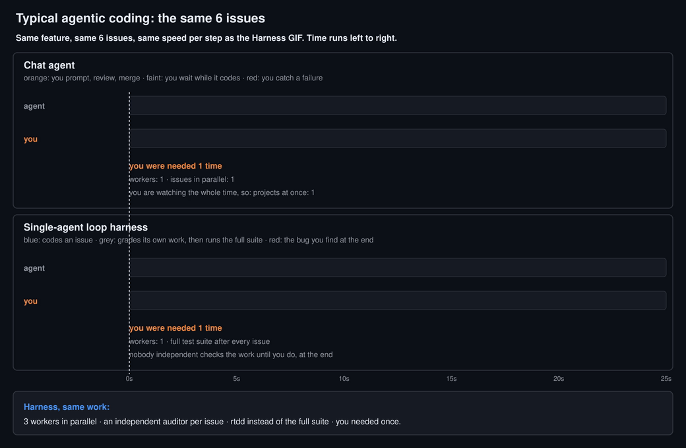

<p align="center">
  
</p>

<h1 align="center">Harness</h1>

<p align="center"><em>One orchestrator, a pool of autonomous agents, all state in GitHub.</em></p>

A project-agnostic agent orchestrator that drives a fixed pool of autonomous Claude Code or Antigravity (`agy`) sessions against a GitHub-issues board. A fixed pool of workers claims dependency-ready units, drives each through a GitHub-issue state machine to COMPLETE. All state lives 100% in GitHub (issues, labels, pushed commits) plus a small local run directory — no database, no daemon. Stateless and resumable from any host.

The point is where the human sits. A typical agent loop, whether a chat agent or a single-agent loop harness, does one issue at a time, and you are its quality gate:



Harness needs you once per project, for the grilling session. The fleet does the rest: it splits the PRD into issues with a blocked-by map, runs three workers in parallel (manager, implementer, auditor, rtdd, merge), sends a failed audit back to the implementer, and runs the gauntlet, which files a new issue for any gap it finds. You are already on the next project:


<sub>Regenerate both with <code>python3 docs/figures/harness_gifs.py</code> (needs python3-gi, pycairo, ffmpeg).</sub>

## Install

Install the engine **once per host**, then drive any number of projects with it:

```sh
curl -fsSL https://raw.githubusercontent.com/VocanicZ/Harness/main/install.sh | bash
```

`install.sh` checks all prerequisites, provisions the required Claude plugins (`superpowers` and `ralph-loop` from the `anthropics/claude-plugins-official` marketplace) and the matt-pocock skills (`to-prd`, `to-issues` from `https://github.com/mattpocock/skills`) into your Claude install (and the `harness-ralph` plugin plus skills into `agy` when present), places the engine at the single host location `~/.harness/engine/`, installs the `/harness` operator skills **once** to your user scope (`~/.claude/skills/`, not vendored per project), installs [rtdd](#test-selection-rtdd) via `npx github:VocanicZ/rtdd` when `npx` is present (which also writes rtdd's agent skill into `~/.claude/skills/` and the equivalent for other agent CLIs on the host), creates the `~/.harness/` host root, and symlinks `harness` onto your `PATH` (`~/.local/bin/harness` → `~/.harness/engine/bin/harness`). If `~/.local/bin` isn't writable it prints the exact `PATH` line to add instead. No engine copy and no skills are cloned into your project.

The `~/.harness/` host root also carries two subdirs created at install time — `poller/` and `snapshots/`. These back the **host poller** (one poll per repo, shared across every fleet on the host): `poller/` holds the refcounted registry + the poller pidfile, and `snapshots/` holds the per-repo snapshot JSON workers read from. The poller is **on by default** (`HARNESS_USE_POLLER=0` opts a fleet out); a fresh install leaves both dirs empty until the first `harness start`. See [Host poller](#host-poller).

Then, from the root of each project you want to drive:

```sh
harness init     # writes that project's config + state under .harness/
```

`HARNESS_HOME` (default `~/.harness`) and `HARNESS_BIN_DIR` (default `~/.local/bin`) override the install location and the symlink directory.

## Prerequisites

| Tool | Notes |
|------|-------|
| `git` | standard |
| `tmux` | session multiplexer used by the worker pool |
| `python3` | runs `issuelib.py` (state machine) |
| `gh` | GitHub CLI — must be **authenticated** (`gh auth login`) |
| `claude` or `agy` | Agent CLI — Claude Code CLI (default) or Google Antigravity CLI (`agy`); see [Supported agent CLIs](#supported-agent-clis) |
| `rtdd` | the lane test loop — names the tests a change needs, in rounds. `install.sh` installs it with `npx github:VocanicZ/rtdd` (needs `node` ≥ 18; without it lanes fall back to full-suite runs). See [Test selection](#test-selection-rtdd). |

### Supported agent CLIs

Harness lists a CLI here only when every feature works for it. Each CLI is one adapter,
`scripts/cli/<cli>.sh`, behind the interface in `scripts/cli/dispatch.sh` (the only file that reads
`HARNESS_CLI`), and `test/test_cli_matrix.sh` runs every row below for every adapter against panes
and files captured from the real CLI. `test/test_cli_readme.sh` fails when this table and the
matrix disagree. Each CLI's facts and their sources: [docs/cli-capabilities.md](docs/cli-capabilities.md).

| feature | what it proves | `claude` | `agy` |
|---|---|---|---|
| verified on | `<cli> --version` of the captured fixtures | 2.1.311 (Claude Code), 2026-10-27 | 1.4.8, 2026-10-27 |
| `fixtures-recorded` | Panes, transcript and usage samples captured from the real CLI (`test/fixtures/cli/<cli>/`) | ✓ | ✓ |
| `launch-bootstrap-prompt` | The launch line carries the fixed bootstrap prompt | ✓ | ✓ |
| `launch-no-task-text` | The task text stays out of argv (#213) | ✓ | ✓ |
| `launch-model` | A lane's model reaches the launch | ✓ | ✓ |
| `launch-effort-once` | A lane's effort reaches the launch, once | ✓ | ✓ |
| `session-id` | Harness knows the CLI's own session id (claude: set at launch; agy: read from `cache/last_conversations.json`) | ✓ | ✓ |
| `idle-is-prompt` | An idle pane is read as the input prompt | ✓ | ✓ |
| `idle-is-not-busy` | An idle pane is not read as a running turn | ✓ | ✓ |
| `busy-is-busy` | Every captured running turn is read as busy (claude: the spinner, which Harness's status line leaves without `esc to interrupt`) | ✓ | ✓ |
| `trust-dialog-is-not-prompt` | The workspace-trust dialog is never mistaken for the prompt | ✓ | ✓ |
| `transient-stalls` | A transient API error at the prompt is a #115 stall | ✓ | ✓ |
| `idle-never-stalls` | A healthy idle pane is never a stall | ✓ | ✓ |
| `busy-never-stalls` | A running turn is never a stall | ✓ | ✓ |
| `limit-parks` | A usage-limit message at the prompt parks the lane (#120) | ✓ | ✓ |
| `transient-is-not-limit` | A transient error is not a limit park | ✓ | ✓ |
| `trust-pre-accepted` | Workspace trust is pre-accepted (claude: `.claude.json` of every account; agy: `trustedWorkspaces` in `settings.json`) | ✓ | ✓ |
| `bypass-covers-subagents` | The session and its sub-agents run without approval prompts (claude: `settings.local.json`; agy: `--dangerously-skip-permissions`, inherited by sub-agents) | ✓ | ✓ |
| `done-signal` | The goal loop's end is seen (the loop state file is gone) | ✓ | ✓ |
| `loop-mode` | The goal loop is driven (both: a Stop hook — `ralph-loop` / `harness-ralph`) | ✓ | ✓ |
| `transcripts-found` | The session's transcripts are found (agy: `conversations/<id>.db`) | ✓ | ✓ |
| `usage-from-transcript` | Per-model token usage is read from them (agy: protobuf rows, decoded) | ✓ | ✓ |
| `stats-session-end-usage` | `harness stats` session_end events carry that usage (#185) | ✓ | ✓ |
| `usage-windows` | Usage windows are read for #194 checkpoints (claude: status line; agy: `agy -p /usage`) | ✓ | ✓ |
| `checkpoint-skill` | `pause --force` names the CLI's handoff skill | ✓ | ✓ |
| `send-and-kill` | Nudges and checkpoints are delivered; a session is ended | ✓ | ✓ |
| `prereqs-named` | `harness setup` names the binary and plugins the CLI needs | ✓ | ✓ |

`agy` lanes need the `harness-ralph` plugin (`plugins/ralph-loop`, installed by `install.sh`): it is
agy's goal loop. Without it a lane runs one turn and stops; `harness setup` reports it missing.

## Pipeline modes

`HARNESS_MODE` selects which orchestration actions the dispatch engine may emit:

| Mode | Entry stage | Orchestration allowed | PRD authored by | COMPLETE when |
|------|-------------|----------------------|-----------------|---------------|
| `issue-only` | IMPL | none (IMPL only) | — | all `ready-for-agent` issues closed and none in-flight |
| `prd` | DECOMPOSE | DECOMPOSE, REVIEW | human (creates one or more `prd`-labelled issues) | every PRD issue closed and labelled `reviewed`, **and** no `ready-for-agent` issue still open |
| `planned` | PLAN | PLAN, PRD, DECOMPOSE, REVIEW | agent (from `HARNESS_SPEC`) | every PRD issue closed and labelled `reviewed`, **and** no `ready-for-agent` issue still open |

The full pipeline is: `PLAN → PRD → DECOMPOSE → IMPL (parallel) → REVIEW → COMPLETE`.
`HARNESS_MODE` gates which stages are active; all modes share the same state machine.

The "no open `ready-for-agent` issue" half of the `prd` / `planned` condition matters because a
closed PRD is not proof the work is done. `CLOSE_PRD` — the engine's own close — is gated on every
ready child being closed, but nothing else that can close a PRD is: a reviewer's own `gh issue
close`, a human, an injected session. Without that half, a PRD closed while one ready issue is
still open makes the unit COMPLETE, and a complete unit is dropped from dispatch **before** the
engine ever asks what work is outstanding — so the issue stays open forever while the fleet
reports success. `issue-only` has always required it; the other two modes were the outliers.

The cost is deliberate: an open ready issue that no lane can claim — blocked by an unclosed
`## Blocked by` ref, or `agent-blocked` on a non-autonomous fleet — now holds its unit incomplete,
and in `multi` topology holds every dependent unit behind it. That is the honest state rather than
a false COMPLETE, and it is not silent: the unit logs one banner naming the outstanding count and
the remedy, deduped so a genuinely stuck unit says it once rather than every poll.

### Several PRDs per unit

A unit may hold several PRD issues at once. PRDs with no `## Blocked by` section run in
**parallel** — their children are dispatched as capacity allows, lowest PRD number first, spilling
into the next PRD when one runs dry. A PRD that declares

```
## Blocked by
#41
```

is held until #41 closes, giving you a strict **one-by-one** sequence. Mix freely: sequence only
what genuinely depends on something else.

Children are attributed to their PRD by a `## Parent` section in the issue body (the decompose
agent writes this; the legacy `Part of #N` trailer is also honoured). A ready-labelled issue with
no parent — an injected task, say — is dispatched first and does not gate any PRD's review. The
unit is COMPLETE only when every PRD is closed and no unparented issue is still open.

Within each bucket (the unparented one, and each PRD's) issues are claimed **resumable first** — an
issue whose remote `issue/<n>` branch exists (so any open PR from it) or that carries `agent-paused`
— then **oldest first** by issue number. A half-finished PR is picked back up before it goes stale,
and the newest injection no longer jumps the queue (#210).

Each eligible PRD gets its own orchestration lane: DECOMPOSE, REVIEW and the engine's own
`CLOSE_PRD` are gated per PRD rather than unit-wide, so two PRDs can orchestrate at once. Their
sessions carry a `-p<n>` suffix and run in per-PRD worktrees, which is what keeps two concurrent
orch agents off each other's checkout.

## Topologies

| Topology | Description |
|----------|-------------|
| `single` | One target repo (`HARNESS_REPO`). The pool drives that one unit; up to `HARNESS_CAP` concurrent impl sessions run inside it. Default. |
| `multi` | Multiple repos in a dependency DAG described by `targets.tsv` (`id → repo → deps → desc`). A target unblocks its dependents when it reaches COMPLETE. Peak concurrency = `POOL × CAP`. |

## Configuration

Harness reads `.harness/config` (a sourceable `KEY=VALUE` file). Any key can be overridden inline: `HARNESS_POOL=5 harness start`. Already-set environment variables take precedence over the file.

| Key | Default | Meaning |
|-----|---------|---------|
| `HARNESS_MODE` | `issue-only` | Pipeline mode: `issue-only`, `prd`, or `planned` |
| `HARNESS_TOPOLOGY` | `single` | `single` or `multi` |
| `HARNESS_OWNER` | _(empty)_ | GitHub owner/org (used to expand bare repo names) |
| `HARNESS_REPO` | _(empty)_ | Target repo for single topology (`owner/repo`) |
| `HARNESS_SPEC` | _(empty)_ | Path to the umbrella spec; `planned` mode only |
| `HARNESS_AUTONOMOUS` | `true` | `true` = agents never park; `false` = agents may apply `agent-blocked` for human help |
| `HARNESS_CLI` | `claude` | Agent CLI to drive: `claude` (Claude Code CLI) or `agy` (Antigravity CLI); one adapter per CLI under `scripts/cli/` ([Supported agent CLIs](#supported-agent-clis)) |
| `HARNESS_AGY_BIN` | `agy` | Executable path for `agy` when `HARNESS_CLI=agy` |
| `HARNESS_AGY_FLAGS` | `--dangerously-skip-permissions --effort high` | Flags passed to `agy` CLI on launch |
| `HARNESS_POOL` | `3` | Number of pool workers (unit-concurrency cap) |
| `HARNESS_CAP` | `3` | Max concurrent claude sessions per unit |
| `HARNESS_POLL` | `300` | Resident-pool poll interval in seconds (idle/steady-state cadence) |
| `HARNESS_PRIORITY_POLL` | `60` | Fast poll interval for the priority bug lane |
| `HARNESS_POOL_TAKES_BUGS` | `1` | `1` = a pool worker with no dispatchable impl work takes the oldest open `bug`/`bug-triaged` issue in its unit's repo while the priority lane is busy (or not running), through the lane's own triage→fix flow; the lane keeps first pick whenever it is free, and the shared bug claim means the two never take the same bug. `0` = bugs wait for the priority lane |
| `HARNESS_SESS_PREFIX` | derived from the project dir at `init` (`hz` for pre-existing configs) | tmux session name prefix — **must be unique per fleet on a host**; a shared prefix makes `harness stop` in one project kill another's agents. See [Fleet prefixes](#fleet-prefixes) |
| `HARNESS_PREFIX_COLLISION` | `refuse` | `refuse` \| `warn` — what `harness start` does when another fleet already owns this session prefix: `refuse` (default) dies, `warn` prints and continues |
| `HARNESS_LABEL_READY` | `ready-for-agent` | Label that marks an issue dispatchable |
| `HARNESS_LABEL_PRD` | `prd` | Label that marks the PRD tracking issue |
| `HARNESS_LABEL_WORKING` | `agent-working` | Label applied while a session owns an issue |
| `HARNESS_LABEL_BLOCKED` | `agent-blocked` | Label applied to issues parked for human help (autonomous=false) |
| `HARNESS_LABEL_REVIEWED` | `reviewed` | Label applied to the PRD issue after review passes |
| `HARNESS_LABEL_COORD` | `coordination` | Optional, human-facing tracking label only. Cross-unit deps are filed as real cross-repo `owner/repo#N` refs in `## Blocked by` (see `prompts/decompose.md`); this label is **not** the work path. |
| `HARNESS_AUTHOR_ALLOWLIST` | _(empty)_ | Comma-separated GitHub logins permitted to author claimable issues. Empty = self-only (secure default); `*` = allow any author. See [Issue-author allowlist](#issue-author-allowlist) |
| `HARNESS_USE_POLLER` | `1` | Host poller, **on by default** (#182): this fleet reads shared host snapshots instead of polling GitHub itself. Empty also means on (configs written before #182 carry an empty value); `0` = direct-`gh` polling. See [Host poller](#host-poller) |
| `HARNESS_WORKTREE_HOOK` | _(empty)_ | Path to a project script run once in every freshly created worktree (and every multi-topology clone), with `cwd` = that worktree and its path as `$1`. Absolute, or relative to the project root. Empty = no-op. See [Provisioning a fresh worktree](#provisioning-a-fresh-worktree) |
| `HARNESS_GAUNTLET_ROUNDS` | `3` | Gauntlet review: rounds allowed before the reviewer concedes and signs off. Only applies to a PRD carrying a `## Quality bar` — see [Gauntlet review](#gauntlet-review) |
| `HARNESS_SECURITY_AUDIT` | `0` | `1` = every PRD review (`prd`/`planned` modes) runs a security audit after the acceptance criteria pass; findings of medium severity or above are filed as gap issues and hold the sign-off. `0` = off. See [Security audit review](#security-audit-review) |
| `HARNESS_SECURITY_AUDIT_ROUNDS` | `2` | Security audit: rounds with filed findings allowed before the reviewer concedes and moves on |
| `HARNESS_CI_GATE` | `0` | Off by default — Harness projects run [no GitHub CI](#no-github-ci--the-gate-is-local). `1` = hold new dispatch while the default branch's own GitHub CI is red (live sessions drain; the bug lane is never gated), for a project that opted back into Actions. Fail-open — no Actions, an in-flight run, or a `gh` outage all dispatch normally |
| `HARNESS_SWARM` | `auto` | `auto` = when [swarm](https://github.com/VocanicZ/swarm) is on `PATH`, lanes run their full-suite verification (the FULL-SUITE BAR baseline + final run, review's suite run) as a swarm job; `off` = always local. No swarm installed → exactly the local behaviour. See [Offloading tests to swarm](#offloading-tests-to-swarm) |
| `HARNESS_SEED_CI` | `0` | `1` = when seeding a `multi`-topology unit repo, commit a language-autodetect `.github/workflows/ci.yml` and set best-effort branch protection requiring its `test` check. `0` = neither — the engine never adds a workflow to your repos unless asked (labels and auto-merge are still set). `1` is an explicit opt-in to GitHub CI, so it also skips `HARNESS_DISABLE_CI` |
| `HARNESS_DISABLE_CI` | `1` | When `harness init` / `harness setup` seed a repo, `gh workflow disable` its existing GitHub Actions and log each one. `1` = test-CI only — a workflow whose name or file says `release`, `deploy`, `publish`, `pages` or `cd` keeps running; `all` = release and deploy too; `0` = touch nothing (the opt-out). See [No GitHub CI](#no-github-ci--the-gate-is-local) |
| `HARNESS_USAGE_CHECKPOINT_PCT` | `90` | At this % of any usage window (Claude Code's 5-hour and weekly limits), checkpoint every live session to GitHub and hold new claims until the window resets. See [Usage-limit checkpoints](#usage-limit-checkpoints) |
| `HARNESS_USAGE_CMD` | _(empty)_ | Your own usage source, for any CLI: a command printing `<account>\t<window>\t<pct>\t<resets_at epoch>` lines. Overrides the CLI adapter |
| `HARNESS_GH_RATE_GUARD` | `1` | `1` = on a GitHub rate limit, sleep the dispatchers until the token's reset instead of retrying every poll, and stop claiming new work when the budget runs low. `0` = off. See [GitHub rate limits](#github-rate-limits) |
| `HARNESS_GH_BUDGET_PCT` | `20` | Below this % of the token's `core` or `graphql` budget, claim nothing new and poll at half rate until the reset, leaving the rest to live agents |
| `HARNESS_GH_RATE_TTL` | `60` | Seconds one `gh api rate_limit` probe is reused by every worker on the host |
| `HARNESS_ORPHAN_LOCK_MIN` | `20` | Minutes an open `agent-working` issue may sit with no live session (impl, orch, or bug lane) and no worktree before the pool worker unlocks it with a comment. A reap whose unlock `gh` refused (an outage) is queued instead and retried every poll until it lands |
| `HARNESS_USAGE_STATUSLINE` | `1` | `1` = set the status line of each Harness-owned Claude Code worktree to `scripts/usage-statusline.sh`, which reports the usage windows (an existing `statusLine` there is kept). `0` = off; Claude usage is then unavailable unless `HARNESS_USAGE_CMD` is set |

### Issue-author allowlist

By default the dispatch engine **only claims issues authored by the authenticated GitHub user** (the login behind `gh api user` — the account the bot commits as, not `HARNESS_OWNER`, which may be an org). This is secure-by-default: it closes a defense-in-depth gap where auto-labeling actions/templates, an over-permissioned or compromised collaborator, or a label-name collision could otherwise inject a `ready-for-agent` issue that the fleet would pick up and act on.

- **Empty (default) — self-only.** Only the bot's own issues (its PRD, decompose, and cross-repo issues included) are claimed.
- **`HARNESS_AUTHOR_ALLOWLIST="alice,bob"`** — additionally trust those logins. The set is *additive to self*: the bot is always allowed, so its own work is never filtered out.
- **`HARNESS_AUTHOR_ALLOWLIST="*"`** — allow any author (community-fleet opt-in), restoring the pre-allowlist behavior.

The check applies to both PRD selection and the implementation claimable filter. Issues from non-allowed authors are **silently ignored** — never claimed, commented, or labelled — with only a local debug line on stderr (no GitHub-visible signal to a prober).

### Provisioning a fresh worktree

Every impl / bug-fix / triage session runs in its own `git worktree`, and a worktree is a **bare checkout of the tracked tree**. Submodules come up as empty directories (`worktree add` never inits them), and anything your main checkout carries untracked — toolchain symlinks, prebuilt engine or SDK binaries, build outputs, import/index caches — is simply absent. For a plain clone-and-go repo that's fine. For anything heavier, the agent starts in a tree that cannot build.

`HARNESS_WORKTREE_HOOK` is the seam. Point it at a script; it runs once per fresh worktree with `cwd` set to that worktree and its path as `$1`:

```sh
# .harness/config
HARNESS_WORKTREE_HOOK=.harness/worktree-hook.sh
```

```sh
#!/usr/bin/env bash
# .harness/worktree-hook.sh — runs inside each new worktree
set -euo pipefail
git submodule update --init --recursive
ln -sfn "$HOME/toolchains/sdk" ./sdk     # symlink big untracked deps, never copy
./scripts/warm-cache.sh
```

Keep it **idempotent** — it may run against a reused path. Failures are logged and swallowed: the session still launches, because a hard failure here would strand the issue under `agent-working` with no session to work it. Empty (the default) is a true no-op.

### Parallel-lane merge safety

Workers branch off the default branch independently and merge back independently, so by the time a lane is ready its base has usually moved. A suite that went green on a lane's branch only proves that change against the base it *started* from, and a conflict-free text merge can still be semantically broken — another lane edited the same function, moved a helper's contract, or rebuilt an artifact the tests load.

The impl / bug-fix / resume prompts therefore require a **rebase onto the current base plus a re-run** immediately before merging, repeated until the rebase is a no-op. The local gate then runs on that rebased head, so it tests the *merge result* rather than the branch as it was started.

The same prompts hold lanes to **no new failures against a baseline** captured before the first edit, rather than a globally green suite. Most real repos carry some pre-existing reds; an autonomous agent told "all green required" will either chase them forever or edit tests until they pass.

### Test selection (rtdd)

The full-suite baseline is the single biggest time cost in a lane, and almost none of it is the merge bar. Held literally it is **two full suite runs per lane** — one before the first edit, one after — plus another on every rebase-and-re-run, times every lane. What actually decides the merge is the local gate running the full suite once, on the rebased head ([No GitHub CI](#no-github-ci--the-gate-is-local)).

So the lane loop is [rtdd](https://github.com/VocanicZ/rtdd) v0.3, not the suite. rtdd builds a graph of the repository's functions and the tests that call them, and names the tests a change needs **in rounds**; it runs none of them — every round runs with the project's own test command. The impl / bug-fix / resume prompts share one short block (`prompts/_rtdd.md`, rendered into each through `{{> _rtdd.md}}`) and leave the details to the user-level `rtdd` skill. In the block's order:

1. **rtdd never blocks a lane.** If it is missing, older than v0.3 (no "Round 1" in its output), or errors, the lane runs the full-suite bar instead: the suite before the first edit and again at the end, with no new failures.
2. **`rtdd which --base origin/<default-branch>`**, re-run after every edit, names Round 1, Round 2 and `untested` (`rtdd --version` first; a host without it installs it once with `npx -y github:VocanicZ/rtdd`).
3. **Lanes set it up themselves, and only that.** With no `.rtdd/config.yaml` the lane runs `rtdd init` once and commits only the files it reports creating (`.rtdd/config.yaml` and the `.rtdd/.gitignore` that keeps the `graph.json` cache out of git). It never commits `AGENTS.md`, `.claude/` or `.cursor/` changes rtdd made — rtdd's instructions come from the user-level skill, which `harness setup` installs once per host with `rtdd skill install` (and, for an `agy` fleet, into agy's user skill dir from `rtdd skill prompt`), warning rather than failing if it cannot.
4. **Round 1** — the tests linked to the code the lane changed — runs with the project's own test command until green, then **Round 2**, the tests of its callers and callees. Both rounds **empty** is never read as green — rtdd has nothing to say about that change, so the lane runs the full-suite bar for it. **`untested`** names changed code no test reaches; the lane writes those tests.
5. **Round 3** — the full suite, once, at the end, before the PR (on swarm when [offloaded](#offloading-tests-to-swarm)) — with the bar **no new failures**. A failing test in any round is not automatically the lane's: it is **re-run against the base** in a throwaway `git worktree add` first, and red there too is pre-existing — left alone and noted.

The bar adds one thing rtdd cannot check: **at least one test fails without the change**. A test that reaches the new code and asserts nothing clears `untested` while proving nothing; only the failing-without-the-change check carries what TDD's red step carried. Nothing here lets a lane weaken a test, or edit one to clear `untested`.

**The merge gate keeps the full suite.** The rounds covered the diff; only the full suite covers what the diff broke elsewhere. So unless the repo ships its own `scripts/ci-local.sh` (which then *is* the gate), the lane runs the full suite on the rebased head before merging — Round 3 counts when it ran there.

**`harness stats` shows how each issue was tested.** Every lane session — `claude` or `agy` — is launched with `RTDD_EVENT_LOG=~/.harness/rtdd-events.jsonl` (`HARNESS_RTDD_EVENTS_FILE` overrides it) plus `HARNESS_SESSION` (the session uuid), `HARNESS_ISSUE`, `HARNESS_KIND`, `HARNESS_PRD`, `HARNESS_PREFIX` and `HARNESS_REPO`. rtdd appends one line per invocation and copies those vars into its `ctx` ([VocanicZ/rtdd#503](https://github.com/VocanicZ/rtdd/issues/503)); the report joins each line to its session on `ctx.HARNESS_SESSION`. Per issue and PRD you get `which` calls, changed nodes, Round 1 / Round 2 sizes, stale-graph count and rtdd wall time; the fleet summary gives the share of `which` calls that were selective vs left the lane on the full suite (an empty selection, a whole-suite / fidelity-`none` selection, or an rtdd error), and how many `harness start`s found no rtdd (`rtdd_missing`). rtdd never runs tests, so pass/fail stays in the transcript. `--backfill` counts the `rtdd` Bash calls (`which`, `init`, and the subcommands v0.3 removed) of older sessions — counts only, no selection data, and Claude transcripts only (agy writes none Harness can read).

#### This repository's own setup

Harness drives itself, so it carries the same setup the prompts ask for: v0.3's `.rtdd/config.yaml` (whose `whole_file_tests` treats each `test/test_*.sh` as one test) and its `.rtdd/.gitignore`. v0.2's footprint — its coverage map, the bash adapter and the xtrace runner it needed, the merge driver, and the `AGENTS.md` / `.cursor` files an older `rtdd init` wrote — was removed with `rtdd init` and `rtdd uninstall --legacy-files`. Every `test/test_*.sh` sources `scripts/lib.sh`, so a change there selects most of the suite in Round 1; that is the graph being right, not wrong.

### No GitHub CI — the gate is local

**Harness disables GitHub CI by default, and no project it drives uses GitHub Actions as its gate.** The only merge gate is local: `scripts/ci-local.sh` (or whatever CI entrypoint the repo ships) when there is one, otherwise the **full suite run locally on the rebased head** — or [on swarm](#offloading-tests-to-swarm). Hosted CI on a fleet's repos was a cost with no verdict worth reading: a private repo on a free plan cannot make a check *required* (branch protection and rulesets both `403`), a billing wall returns a two-second zero-step "failure" no branch change can fix, and every lane push burns Actions minutes.

| Piece | Where | What it does |
|---|---|---|
| Gate locally before merging | `prompts/impl.md`, `prompts/bug-fix.md`, `prompts/resume.md` | Immediately before the merge step, run `scripts/ci-local.sh` if the repo ships one, else the full suite on the rebased head (no new failures vs the lane's baseline). `gh pr checks`, an Actions run, or mergeable-state is **never** the gate and never permission to merge. Red → fix and retry up to 3 times, then leave the PR **open**, comment the failing step on the issue, and end **without** the completion promise. Explicitly overrides "never park": that means never wait on a human, not merge anyway. Editing the local CI script to go green is the same offence as deleting a test. |
| Switch existing CI off | `HARNESS_DISABLE_CI` (`seed.sh`, run by `harness init` and `harness setup`) | `gh workflow disable` on each active test-CI workflow, logging which. Release and deploy workflows (`release`, `deploy`, `publish`, `pages`, `cd` in the name or file) keep running unless `HARNESS_DISABLE_CI=all`; `HARNESS_DISABLE_CI=0` opts out; `HARNESS_SEED_CI=1` opts back into GitHub CI and disables nothing. |
| Never add CI | `HARNESS_SEED_CI` (default `0`) | Seeding commits no workflow and no CI-requiring branch protection unless asked. |

#### Opting back in: the default-branch CI gate

A project that *does* run GitHub CI can set `HARNESS_CI_GATE=1`: before each poll's dispatch the pool checks the default branch's own CI, and while it is red no new sessions spawn; live ones drain untouched, and the next poll resumes automatically once it is green. It is off by default because with GitHub CI disabled there is nothing for it to read.

The gate is **fail-open** on purpose — a fleet that halts on uncertainty is worse than one that merges a bad commit. Only a positively-failed *most recent completed* run of some workflow counts as red; no Actions at all, nothing completed yet, an unrecognised conclusion, or a `gh` outage all dispatch normally. A stale red behind a newer green does not gate, and `cancelled` is never treated as a failure. The **priority bug lane is deliberately not gated**, because it is the remedy: filing a `bug` issue is how a fleet digs a red default branch back out.

### Gauntlet review

Review normally grades the build against the PRD's own `## Acceptance criteria`. That bar is
self-referential — the same fleet wrote the PRD, decomposed it, and implemented it — so a pass
means "it meets the spec we wrote", never "it is any good".

A PRD may opt in to a harder gate by carrying one extra section:

```markdown
## Quality bar
Beat: ripgrep — https://github.com/BurntSushi/ripgrep
Judged on:
- time to first result on a 1M-line tree
- output legibility for a multi-file match
```

When it is present and every acceptance criterion already passes, the reviewer runs a **gauntlet
round**: it provisions the named reference, runs one fixed task list against both artifacts,
writes the two results into unlabelled `A/` and `B/` directories under
`.harness/gauntlet/<unit>/r<round>/`, and hands only those two paths to a **fresh-context critic
sub-agent**, which returns a binary winner plus the single largest gap. No scores — numeric
scoring drifts upward every round.

If ours wins, the PRD is signed off. If it loses, the reviewer files **one** `ready-for-agent`
issue for that one gap and leaves a `<!-- harness-gauntlet round=N -->` comment on the PRD; the
pool implements it and review runs again at round N+1. The loop is the ordinary
REVIEW → IMPL → REVIEW path — no new pipeline stage.

The bar must be **named** (a specific artifact, not a category), **fetchable** (the reviewer can
clone, install, run, or open it), and **comparable** (both can sit side by side and a judge can
pick one). A PRD with no `## Quality bar` reviews exactly as it always has, so this is off unless
a PRD asks for it.

**Rounds are capped** by `HARNESS_GAUNTLET_ROUNDS` (default `3`). At the cap the reviewer concedes:
it comments the standing gap and signs off. A bar can be honestly unbeatable, and an autonomous
fleet has nobody to call the loop off — without a cap one PRD would burn the budget forever and,
in `multi` topology, block every dependent target behind it. A reference that cannot be
provisioned (paywalled, no public build) is treated the same way: comment why, sign off on the
criteria alone. The reviewer never parks a quality gate behind `agent-blocked`.

**Blindness here is prompt discipline, not a sandbox.** The reviewer wrote the side mapping, so it
knows it; only the critic sub-agent is blind, via fresh context plus an explicit instruction not to
read outside the two directories. A determined agent could peek — the same trust model as the rest
of the engine.

Credit: the pattern is Matt Shumer's [Gauntlet Loop](https://github.com/robonuggets/gauntlet-loop).

### Security audit review

Off by default. Set `HARNESS_SECURITY_AUDIT=1` (or answer `1` at `harness init` in `prd`/`planned`
mode) and every PRD review gains a phase between the acceptance-criteria gate and the gauntlet:
the reviewer runs the security-audit skill vendored at `vendor/security-audit/` in the engine —
`quick` profile, scoped to the files changed by the PRs that closed that PRD's children — and
writes its run into `.harness/security-audit/<unit>/p<prd>/r<round>/`.

- Each **confirmed** finding of **medium** severity or above becomes one `ready-for-agent` gap issue
  under the PRD. The reviewer leaves a `<!-- harness-security-audit round=N -->` comment and
  withholds `reviewed`; the pool fixes the findings and review runs again. The loop is the ordinary
  REVIEW → IMPL → REVIEW path.
- **Low/informational** findings and **needs-validation** leads are listed in a PRD comment and never
  hold the PRD open.
- **Rounds are capped** by `HARNESS_SECURITY_AUDIT_ROUNDS` (default `2`). At the cap the reviewer
  comments the standing findings and moves on, exactly like the gauntlet cap.
- The audit's own execution rules apply: source review plus sandboxed local checks only. It never
  probes a deployed service or uses a real credential.

Round markers — this one and the gauntlet's — only count when the fleet's own GitHub login wrote
them. Anyone who can comment on a PRD can post the marker text, so an outsider's copy is ignored
and can never push a review past its cap.

## Offloading tests to swarm

A lane's full suite — the FULL-SUITE BAR baseline and final run in `impl.md` / `bug-fix.md`, the
same pair in `resume.md` (including its baseline worktree), and review's "Run the test suite" — can
run as a [swarm](https://github.com/VocanicZ/swarm) job on the coordinator and spare machines
instead of in the lane's own session. With `HARNESS_SWARM=auto` (the default) the prompts call:

```bash
scripts/swarm-suite.sh <worktree> <job-name> [test files...]
```

| Exit | Meaning | The lane then… |
|---|---|---|
| `0` | every test file passed | treats the run as green |
| `1` | red — each failing file is printed with its shard's `output.log` dir | compares the failures against the baseline, as for a local run |
| `3` | not run on swarm: no `swarm` on `PATH`, `HARNESS_SWARM=off`, the job timed out (it is cancelled), or the job failed with no failing file listed | runs the suite locally, exactly as today |

The bar itself does not change: **no new failures vs the baseline**, wherever the suite ran.

How the job is built (the [swarm.toml contract](https://github.com/VocanicZ/swarm/blob/main/skill/SKILL.md)):

- The job dir is `$RUN_DIR/swarm/<job-name>/` — never inside the worktree.
- **Only what git sees is packed.** The job's `workdir` is a hardlinked snapshot of the worktree
  staged in the job dir: tracked files (submodules' tracked files included) plus untracked files
  that are not ignored — so ignored build output and caches (`.godot/`, `node_modules/`, `build/`)
  never reach swarm's `workdir.tar.gz`. A `.swarmignore` in the worktree (tar `--exclude-from`
  patterns) trims it further, e.g. large tracked assets the tests never read.
  `HARNESS_SWARM_PACK=all` tars the whole worktree instead, ignored files included.
- **The tarball does not outlive the job.** Once the job has merged, failed or been cancelled on
  timeout, `~/.swarm/jobs/<job-name>/workdir.tar.gz` (and the `.prev` copy of the last run) is
  deleted; results and logs stay.
- **One shard per test file.** No files named → every tracked `test_*` / `*_test` `.sh`/`.py` file.
  Shard ids are the path with every byte outside `[A-Za-z0-9.-]` escaped as `_` + 3 octal digits,
  so `test/sub dir/test_a.sh` becomes `test_057sub_040dir_057test_137a.sh` — valid for swarm, and
  decodable by the shard itself on a worker that cannot read the job dir. `shards.tsv` in the job
  dir maps each id back to its path.
- `run` executes that one file — `bash` for `.sh`, `python3` for a `.py` with a `__main__` block,
  `pytest` otherwise, or `HARNESS_SWARM_TEST_CMD` (`{file}`, optional `{junit}`) — and writes
  `status`, `output.log` and `junit.xml` into `{out}`. It always exits 0: a red file is a finished
  shard, not one to retry; a shard stopped mid-test has no `status` yet and reruns that file.
- `merge` writes `failures.txt` (file, status, out dir) and `summary.txt`, and exits 1 when any file
  failed — which is what `swarm wait` reports.
- `HARNESS_SWARM_TIMEOUT` (default `1800`) is the `swarm wait` budget in seconds.

A lane already running keeps the prompt it was rendered with; a host without swarm never sees a
difference.

## Commands

`harness` is on your `PATH` after install; run it from inside any project you've `harness init`'d:

```
harness <command>
```

| Command | Description |
|---------|-------------|
| `init` | Interactive setup wizard — writes `.harness/config`, creates missing GitHub labels, seeds the target repo(s) |
| `start [--recover]` | Launch the worker pool. `--recover` sweeps stale pidfiles, claims, and orphaned `agent-working` labels before launch |
| `stop [--clean]` | Stop the pool. `--clean` also removes worktrees |
| `status [--watch [secs]] [--all]` | One-shot or live dashboard: pool state, per-unit progress, live sessions, gated units. Outside any project (or with `--all`) it shows **every fleet on the host** from `~/.harness/fleets`: state (RUNNING / PAUSED / STOPPED / COMPLETE / DEAD / missing), live sessions with issue, age and model, open / unblocked / agent-working counts with orphaned locks flagged, last log line, HOLD streaks, and the GitHub budget |
| `stats [--prd N\|--issue N] [-R owner/repo]` | Host-wide event log report (`~/.harness/events.jsonl`, every project): per fleet over the last 7 days — sessions, tokens by model, issues/PRDs closed, retries, HOLD minutes. `--prd` rolls each child issue's sessions (model/effort, tokens, wall time, retries) up to the PRD; `--issue` is a per-session timeline. Filters `--since 7d\|24h\|YYYY-MM-DD`, `--fleet <prefix>`, `--model <substr>`; `--json` for machines; `--backfill` rebuilds `session_end` usage for past sessions from their Claude transcripts, and counts the `rtdd` calls of sessions that predate the rtdd event log. Every level also reports rtdd activity — see [Test selection (rtdd)](#test-selection-rtdd) |
| `doctor [--fix]` | Diagnose what strands a pool — who holds `start.lock`/`pool.lock` (via a dependency-free `/proc` scan, so it works without `fuser`/`lsof`), orphaned lock-holders (a killed worker's leaked poll-`sleep`), and stale pidfiles. Report-only by default; `--fix` clears stale pidfiles and reaps **this project's** orphans (never touches a co-resident sibling fleet) |
| `attach <unit> [issue]` | tmux-attach to a running session |
| `migrate` | Convert a project's **vendored** `.harness/` (the pre-shared-engine layout) to state-only and re-point it at the shared engine. Idempotent; refuses if no shared engine is installed |
| `poll [--once\|--status]` | Host-level debug entry to the shared snapshot poller. `--once` refreshes every registered repo once; `--status` reports the poller pid + registered slugs/cadences. Normal operation needs no manual `poll` — workers self-heal it (see [Host poller](#host-poller)) |
| `supervise [--once] [--dry-run]` | Host-level supervisor for **every fleet on the host**: restarts dead pool/priority workers, clears orphaned `agent-working` locks, nudges — then checkpoints to GitHub and kills — sessions frozen at their prompt, and runs the arc stall rules. `--alarms` lists the alarms still firing; `--install` / `--uninstall` manage its systemd user unit. See [Host supervisor](#host-supervisor) |
| `web` | Read-only **dashboard** of every fleet on the host, served in the foreground on `http://127.0.0.1:4637/`: each registered fleet with its state and a link to its page, from local snapshots only. `--install` / `--uninstall` manage its systemd user unit. See [Dashboard](#dashboard) |
| `plan "<brief>"` | Inject a plan/topology change (PLAN.md / `targets.tsv`, incl. seeding a new target repo) into a **live** fleet. Grill via [`/harness-plan`](#per-command-shortcuts) |
| `prd "<brief>"` | Extend a **live** fleet's PRD scope and create the delta issues. Grill via [`/harness-prd`](#per-command-shortcuts) |
| `issue "<brief>"` | Inject a discrete implementation issue (or a few) into a **live** fleet. Grill via [`/harness-issue`](#per-command-shortcuts) |

### Which project a command acts on

`STATE_DIR` is the project's `.harness/`. Normally you never set it: every command walks **up** from
the current directory for a `.harness/config`, the way `git` finds `.git`.

A pre-set `STATE_DIR` still overrides that discovery — an out-of-tree or vendored layout needs it —
but an **inherited** one that points at a *different* project is refused:

```
harness: STATE_DIR is set to /home/you/projA/.harness (inherited from the environment),
  but this directory belongs to /home/you/projB/.harness.
  Refusing to act on a project you are not in.
  Run with --state-dir <path> to be explicit, or 'unset STATE_DIR' to use this directory.
```

This is not hypothetical: a Claude session launched **inside** a fleet inherits that fleet's exported
`STATE_DIR`, so `cd`-ing to another project and running `harness stop` used to stop the fleet you came
*from*, and report success (2026-08-12; issue #168). The refusal covers every project command,
`uninstall` included.

| Situation | Behaviour |
|-----------|-----------|
| No `STATE_DIR` set | Discovered from the current directory (the normal path) |
| Inherited `STATE_DIR`, agrees with discovery — or cwd is inside that state dir (a worker's worktree) | Allowed, silently |
| Inherited `STATE_DIR`, nothing discoverable from cwd | Allowed — the out-of-tree / vendored case |
| Inherited `STATE_DIR`, disagrees with discovery | **Refused**, non-zero, naming both paths |
| `harness --state-dir <path> <cmd>` (or `<cmd> --state-dir <path>`) | Always allowed — deliberate, not inherited |
| `HARNESS_STATE_DIR_OK=1` | Always allowed — waives the check for a whole shell |

## Pause / resume / update

```bash
harness pause           # soft drain — stop claiming; live agents finish (local)
harness pause --force   # checkpoint every agent to GitHub, then idle
harness resume          # clear pause; resume here, or start --recover elsewhere
harness update          # ff-pull the one shared engine install (every project picks it up)
harness setup           # verify prereqs + seed labels on all units (no start)
```

**Cross-machine pause/resume.** `pause --force` tells each running agent to commit + push its WIP
branch, post its `/handoff` context as a GitHub issue comment, and label the issue `agent-paused`.
Because all of that lives in GitHub, you can `resume` on a *different* machine: it runs
`start --recover`, re-dispatches the `agent-paused` issues, and each agent fetches its branch, reads
the handoff comment, and finishes the work.

**`update` never touches your config.** It runs `git pull --ff-only` on the single shared engine
install (`~/.harness/engine`) and nothing else — no project `.harness/` is touched, and it never
runs a destructive git op. Because every project shares that one install, one `update` updates them
all at once (no per-project re-pull, no version skew). Live workers keep the old engine logic until
you relaunch (`pause` → drain → `stop` → `start --recover`).

New config keys: `HARNESS_LABEL_PAUSED` (default `agent-paused`), `HARNESS_PAUSE_GRACE` (default `300`s).

### Usage-limit checkpoints

A session cut off by a plan usage limit mid-task holds work that exists only in its worktree. So
every poll Harness reads each account's usage windows through the CLI adapter, and when any window
reaches `HARNESS_USAGE_CHECKPOINT_PCT` (default 90%) it:

- sends every live impl and bug-lane session on that account the same checkpoint as
  `pause --force`: commit + push the WIP branch, post a `<!-- harness-handoff -->` comment, and
  swap the label to `agent-paused`;
- stops claiming new work (pool and bug lane) until the window resets, then resumes by itself: the
  `agent-paused` issues re-dispatch through the normal resume path.

A session already frozen at a limit cannot run `/handoff`, so it gets a **mechanical** checkpoint:
Harness commits and pushes its worktree (to a `-checkpoint-<time>` side branch if `origin` has
diverged) and posts a handoff comment with the last screen. The session is left running, and keeps
its `agent-working` label, so the existing limit watchdog resumes it when the limit resets. This
also fires on the limit message itself, so a CLI that cannot report usage is still checkpointed.

| CLI | Usage source |
|-----|--------------|
| `claude` | The status-line `rate_limits` data (`five_hour`, `seven_day`), wired per worktree by `HARNESS_USAGE_STATUSLINE`. The account is the `CLAUDE_CONFIG_DIR` the pane runs under |
| `agy` | `agy -p "/usage" --output-format json` (runs no turn): each model group's `5h` and `weekly` buckets, reported as used = 100 − remaining. The account is the model group (`Gemini Models`, `Claude and GPT models`). Cached `HARNESS_AGY_USAGE_TTL` seconds (120) |

Each checkpoint and resume is appended to `~/.harness/events.jsonl` as a `usage_checkpoint` /
`usage_resume` event, and `harness status` shows every window, with `HOLD` on an account being
waited out. New panes pick their account at launch, so a hold on any account holds every claim of
the fleet.

### GitHub rate limits

Every fleet on a host, and every agent session in it, spends **one GitHub token's** budget. A
rate-limited dispatcher used to HOLD and retry every poll, spending more of the budget the agents
needed to finish their own `gh` calls. Now:

- **On a rate limit** (a `rate limit` / HTTP 403 / HTTP 429 failure) Harness reads the reset time
  from `gh api rate_limit` (which does not count against the budget) and records a hold for that
  token in `~/.harness/ghrate/`. Until the reset, every engine `gh` read refuses before calling
  `gh`, and the pool workers, the bug lane, `drive_unit` and the host poller sleep until then,
  logging one line per hold. Live sessions keep running and the watchdog keeps tending them. A
  secondary limit names no reset, so it holds one minute. A 403 with budget left is a permission
  error and holds nothing.
- **Budget guard.** When `core` or `graphql` `remaining` falls below `HARNESS_GH_BUDGET_PCT`
  (default 20%), the dispatchers stop claiming new work and poll at twice their interval until the
  reset. The reaping sweeps still run, because they are how finished work gets closed.
- `harness status` shows every token seen on the host: remaining budget and reset time per
  resource, with `HOLD` on a token being waited out. A token from `GH_TOKEN` / `GITHUB_TOKEN` is
  listed by a hash, never by value; gh's own stored login is `gh-auth`.

The token is what is limited, not the agent CLI, so this works the same for `claude` and `agy`.

**Optional: a GitHub App token per org.** For fleets on org repos, an installation token from a
GitHub App installed on that org has its own budget (5,000+/hour, scaling with the org's repos).
The user token then stays free for personal repos, and the agents and dispatchers stop competing
for one budget. Harness does not mint App tokens itself. Installation tokens expire after an hour,
and the workers are long-lived, so a `GH_TOKEN` exported once in `.harness/config` goes stale.
Instead, put a small `gh` wrapper ahead of the real one on that fleet's `PATH`: it mints and caches
the installation token with your App's private key (`POST /app/installations/<id>/access_tokens`),
refreshes it before it expires, and runs the real `gh` with `GH_TOKEN` set. Holds and budgets are
keyed by the `GH_TOKEN` / `GITHUB_TOKEN` in the dispatcher's own environment. A wrapper that sets
the token only inside `gh` is still keyed as `gh-auth`, so its holds are shared with any other
fleet on the host that uses `gh-auth`.

## Host supervisor

Nothing inside a fleet can restart a worker that died, and a session frozen at its prompt holds its
issue lock forever. `harness supervise` watches every fleet on the host from outside. It finds them
in the fleet registry (`~/.harness/fleets`) plus `~/*/.harness`. A fleet that is `PAUSED`, or that has
no worker pid files because it was stopped on purpose, is skipped. Each pass (every `INTERVAL`
seconds):

1. **Dead workers.** A pool or priority-lane pid file whose process is gone → `harness start` for
   that fleet.
2. **Orphan locks.** An open `agent-working` issue with no live `<prefix>-*` session, labelled more
   than `LOCK_GRACE` seconds ago → the label is removed with a comment, and the pool re-dispatches it.
   The pool does this for its own units every poll as well (`HARNESS_ORPHAN_LOCK_MIN`), so this is
   the backstop for a fleet whose workers are down.
3. **Frozen sessions.** A pane is *active* if, since the last pass, the text above its input prompt
   changed, a background-agent or shell timer in the footer moved, or its process tree used more than
   `CPU_ACTIVE_S` CPU seconds (long builds and tests count). After `NUDGE_MIN` minutes with no
   activity, the supervisor clears the input line and sends one nudge, at most once per `RENUDGE_S`.
   If the nudge is ignored and the pane stays quiet until `KILL_MIN`, the session's work is
   checkpointed and the session is killed, so the pool reaps and re-dispatches it:
   - WIP in its worktree is committed (`--no-verify`, never `.claude/` or `.harness-task.md`) and
     pushed to its branch. If that branch has diverged, it goes to `<branch>-checkpoint-<ts>`
     instead. Nothing is ever force-pushed.
   - A `<!-- harness-handoff … -->` comment with the last screen is posted, and the relaunch resumes
     from it.
   - **If nothing can be pushed, the session is not killed.** An `ERROR` is logged for a human.

   The supervisor only types into an idle input prompt, never into a dialog or menu. It leaves alone
   any pane showing a usage, credit or rate-limit message. The prompt patterns come from each CLI
   (`claude`, `agy`).

   **Stuck turns** are checked before activity. Text typed into a pane mid-turn only queues in the
   input box, and a lane polling a long job can stay in one turn for hours. Its spinner timer ticks
   every second, so it never looks quiet, yet nothing typed into it lands. A pane whose turn has run
   `HARNESS_TURN_MAX` seconds (default 4 h) with input queued, or with a Harness nudge still queued a
   pass later, gets Escape, then Enter once it shows `Interrupted`, so the queued text is submitted.
   A long turn with an empty input box is a long tool call and is left alone. The fleet watchdog
   does the same on every poll and logs a `turn_interrupted` event (turn length, queued nudges) for
   `harness stats`.
4. **Other agent panes.** Agent panes outside Harness, whose tmux session matches `EXTRA_RE`, get the
   same activity test after `EXTRA_MIN` minutes. They are nudged only, never killed, because nothing
   re-dispatches them.
5. **Offline host.** While `ONLINE_URL` is unreachable, every action is held. When the network
   returns, every pane is re-armed for an immediate nudge.
6. **Arc stall rules** (from the `/harness-arc` watchdog). Each must hold for 2 or more consecutive
   passes. The strike counts and each PRD's criteria-gate round count are kept in
   `~/.harness/supervise/rules/<prefix>.json`, so a supervisor restart resets neither.
   - Fixed automatically: a **wedged** session (`STOP_HOOK_BLOCK_CAP` in its pane) is checkpointed
     and killed like a frozen one. A **zombie** session, still alive after its issue closed, is
     killed, and checkpointed first if it holds unpushed work. **Unlocked work**, a live session
     on an open issue with no `agent-working`, gets the label back.
   - Alarm only, for a human to decide: **review loop** (a PRD at the criteria gate 4+ times),
     **no frontier** (open children, none unblocked, no session), **decompose stalled**,
     **unfiled plan tasks** (a plan on the default branch naming tasks with no issue; list
     topped-up plans in `.harness/reconciled-plans`), **missing `## Parent`** (not in
     `issue-only` mode), **wayfinder leak**, and **deep context** (a pane past 250%).
     `harness supervise --alarms` lists every alarm still firing.

Every action, alarm and resolution is logged to `~/.harness/supervise.log`. `harness supervise --once
--dry-run` previews a pass without acting (and without advancing the rule-6 strike counts). Knobs are bash assignments in `~/.harness/supervise.conf`:

| Knob | Default | |
|------|---------|-|
| `INTERVAL` | `300` | seconds between passes |
| `LOCK_GRACE` | `1200` | seconds an orphaned `agent-working` label must age before it is cleared |
| `NUDGE_MIN` / `KILL_MIN` | `45` / `120` | quiet minutes before the nudge / the checkpoint-and-kill |
| `RENUDGE_S` | `10800` | at most one nudge per pane in this many seconds |
| `CPU_ACTIVE_S` | `10` | CPU seconds per pass that count as activity |
| `EXTRA_RE` / `EXTRA_MIN` | empty / `60` | tmux session regex for non-Harness agent panes, e.g. `'^hg2(-loops)?$'` |
| `ONLINE_URL` | `https://api.anthropic.com` | reachability probe for the offline hold |
| `UNPARENTED_OK` | empty | comma-separated issue numbers exempt from the missing-`## Parent` alarm |

`harness supervise --install` writes and starts the systemd user unit `harness-supervise.service`
(`Restart=always`, `KillMode=process` so a restart never takes down the fleets it started) and
enables linger, so the unit keeps running after you log out. The unit's `PATH` holds the directories
of `claude`, `agy`, `gh`, `rtdd`, `tmux` and `git` as found at install time. A missing `rtdd` is
warned about, because without it every relaunched lane falls back to the full test suite.
`harness update` rewrites and restarts an installed unit from the updated engine. `harness
supervise --uninstall`, or uninstalling the engine, removes it.

When a session's worktree is reaped, its scratch goes too: its Claude Code scratch dir
(`/tmp/claude-<uid>/<worktree path>`) and the `/tmp/hz-*-<issue>` base checkouts the lane prompts make.

## Dashboard

`harness web` serves a local, read-only dashboard in the foreground (Ctrl-C stops it). Its overview
at `/` lists every fleet registered on the host (`~/.harness/fleets`, the same list `harness status`
shows outside a project) with its state (running / paused / stopped / complete / dead / missing), its
repos' open / unblocked / `agent-working` counts and workers, and links each one to `/fleet/<prefix>`.
Every view carries a **data as of** stamp: the `generated_at` of the oldest board snapshot it used,
so a stalled poller shows as stale data rather than as a quiet fleet. `/api/host` and
`/api/fleet/<prefix>` return the same views as JSON.

Open pages update live, with no reload. Each page subscribes to `GET /events?view=<page>`, a
Server-Sent Events stream. The server checks its local inputs every `HARNESS_WEB_TICK` seconds: the
board snapshots, the event log, the run dirs, the supervisor and rate-limit files and `tmux ls`. When
one changes, it pushes the page parts that changed. An issue opened, closed, labelled or claimed
appears within one board-cache refresh, and the **data as of** stamp moves with it. A dropped stream
reconnects by itself, and the header says "reconnecting…" until it does.

| Variable | Default | Meaning |
|---|---|---|
| `HARNESS_WEB_BIND` | `127.0.0.1` | address the server listens on |
| `HARNESS_WEB_PORT` | `4637` | port the server listens on |
| `HARNESS_WEB_TICK` | `2` | seconds between the live-update checks of local state |
| `HARNESS_WEB_MAX_STREAMS` | `32` | open live-update streams allowed; the next one gets `503` |

By default only the host itself can open it. The claude host sets `HARNESS_WEB_BIND=0.0.0.0` so the
dashboard can be opened from the LAN.

To keep it running, install it as a systemd user unit:

```bash
harness web --install                              # this host only, 127.0.0.1:4637
HARNESS_WEB_BIND=0.0.0.0 harness web --install     # the claude host: open from the LAN
```

`--install` writes and starts `harness-web.service` (`Restart=always`, `WantedBy=default.target`)
with the bind and port from the shell it runs in, and enables linger, so the dashboard comes back
after a crash, a `systemctl --user restart` and a reboot, with no login session open. Re-running it
is idempotent; a re-run with neither variable set keeps the unit's current bind and port. `harness
update` rewrites and restarts an installed unit from the updated engine (keeping its bind and port)
and installs nothing on a host without one. `harness web --uninstall`, or uninstalling the engine,
removes it.

**Read-only is its only protection.** There is no login. Every route answers `GET` and `HEAD` and
refuses every write method with `405`. Pages read only local state (the fleet registry, the host
poller's board snapshots, each fleet's run dir and config) and never call `gh`, so opening the
dashboard spends none of the GitHub budget. Never expose the port to the Internet. The look is copied
from the owner's design-to-print tokens into `web/static/` (each file names its source commit),
with light and dark themes from the same tokens, and no build step.

## Host poller

When several fleets share one host and **one GitHub token**, the dispatch reads stack up: every
pool worker and the priority bug lane each run a full `gh issue list` (+ plan-file reads) every
poll, so GitHub read volume scales with **workers × repos × fleets**. The reads are largely
redundant — everyone recomputes from the same per-repo issue list — and under load a worker gets
rate-limited and can't dispatch, so the fleet looks "stuck" until the token resets.

The **host poller** consolidates that into **one poll per repo**. A single host-level process
refreshes a raw, versioned snapshot per registered repo into `~/.harness/snapshots/`, and workers
read the snapshot instead of polling GitHub. GitHub read volume becomes a flat function of *repos*,
independent of worker and fleet count. Crucially, only the *polling* is centralized: each project
still computes dispatch **locally with its own env**, so it keeps its own session prefix, mode,
topology, label set, and author allowlist.

**On by default.** Since #182 every fleet uses the poller unless its config sets
`HARNESS_USE_POLLER=0` (direct-`gh` polling). An empty value — what configs written before #182
carry — means the default, so those fleets switch over on their next `harness start`.

**Incremental refresh (#182).** The previous snapshot is the cache. A refresh asks REST only for the
issues updated since the last one (`GET /repos/{r}/issues?state=all&since=…`) and sends the stored
`ETag`; an unchanged board answers `304 Not Modified`, which GitHub does **not** count against the
rate limit. `PLAN.md` and the plan-completion marker ride one conditional listing of the repo root,
and the bot login is reused from the cache. The remote `issue/<n>` branches dispatch orders by
(#210) ride one more conditional listing (`git/matching-refs/heads/issue/`), recorded as
`issue_branches`. So a quiet board costs **zero** rate-limited calls per
poll, and a change costs the delta alone. Because `since` never reports a deleted or transferred
issue, a full resync (`gh issue list`, the old path) still runs every `HARNESS_FULL_RESYNC` seconds
(default `3600`) and whenever there is no usable previous snapshot. A transient failure (rate limit,
5xx, network) keeps the prior snapshot; a non-transient one the incremental path cannot use falls
back to a full resync.

`## Blocked by` refs the snapshot cannot answer itself — into a repo no fleet polls, or to a PR
(`gh issue view` calls a merged one `MERGED`) — are resolved by the **poller**, recorded under the
snapshot's `ext_deps`, and cached for `HARNESS_DEP_TTL` seconds (default `600`; a closed/merged state
holds until the next full resync). Workers still make no `gh` call to read them.

**Layout** (under the `~/.harness/` host root):

```
~/.harness/
├── poller/
│   ├── registry/<owner__repo>__<project>.json   one per (repo, fleet): slug, cadence, prefix, project
│   └── poller.pid                                the poller — a background process, NOT a tmux session
└── snapshots/<owner__repo>.json                  {schema_version, generated_at, slug, issues[], has_plan,
                                                   plan_marker, self_login, ext_deps, issue_branches,
                                                   sync{since, etags, full_at}}
```

**Self-healing — no daemon to manage.** There is no operator-facing poller lifecycle command:
`harness start` brings it up, and every worker/bug-lane tick re-checks and relaunches it, so a
crashed poller self-heals within one tick. Because it is a plain background process (not a tmux
session), `harness stop` never kills it — correct, since other fleets on the host may still need
it. `harness stop` only removes *this* fleet's registry entries; a repo stays polled until every
referencing fleet has deregistered (refcount).

**Stale → hold, never fall back to `gh`.** A worker treats a snapshot as fresh only within
`3 × refresh-interval`. A stale/missing snapshot **holds new dispatch** (claims no new work) while
leaving in-flight sessions running, logs a deduped banner, and relaunches the poller — it never
falls back to polling GitHub directly (that would reintroduce the stampede). Dispatch resumes
automatically once the snapshot is fresh again.

`harness poll --status` reports whether the poller is alive plus the registered slugs and their
cadences; `harness poll --once` forces a single refresh pass (debug/test). Normal operation needs
neither — the workers manage the poller for you.

### Rollout / rollback

Since #182 the poller is on by default. After `harness update`, each fleet switches over on its next
`harness stop && harness start --recover`: on start it registers its repos and brings the poller up,
and the pool and bug lane become snapshot-served. To check one: its worker logs show no
`gh issue list` for dispatch, the poller is writing `~/.harness/snapshots/<slug>.json`, and
`harness poll --status` shows the slug registered.

**Rollback** is per fleet: set `HARNESS_USE_POLLER=0` in its `.harness/config` and
`harness stop && harness start --recover`. That fleet returns to direct-`gh` polling immediately. Snapshots are ephemeral (regenerated), so there is no migration
state to undo.

## Fleet prefixes

A fleet owns **every tmux session under its prefix**: `harness stop` and `harness status` match
`^<prefix>-.+$`, because ERE has no negative lookahead and "anything except an impl suffix" is not
expressible. That rule is sound for one fleet and destructive for two — give two fleets the same
`HARNESS_SESS_PREFIX` and either one's `harness stop` tears down the other's live agents mid-edit,
whatever units they are working on.

The trailing dash is what keeps siblings apart, so `hz`, `hzli` and `boto` coexist happily —
`hzli-main-i7` is not inside `hz-`'s space. Only equal prefixes, or one being a dash-prefix of the
other, collide.

### Prevention: a distinct prefix per project

`harness init` derives a prefix from the project directory name (`~/proj/Harness` → `harness`),
offers it as the default, and writes it to `.harness/config` — so a second fleet on the host never
lands on the first one's prefix by accident. Projects initialised before this existed have no prefix
line and keep the historical `hz` default; set `HARNESS_SESS_PREFIX` in their `.harness/config` if
more than one fleet runs on the host. The engine never edits `.harness/config` for you, and never
starts under a prefix other than the configured one.

### Detection: `harness start` refuses a shared prefix

`harness start` refuses when another fleet already owns this prefix, naming the project that holds
it and the retry command. It discovers other fleets **three** ways and takes the union, because each
sees something the others cannot:

- **Live tmux sessions** — the enforcement signal. A session in our prefix space is attributed to its
  owning project by the session's working directory, so this works against a fleet running an older
  engine, a hand-set prefix, or a session made by hand. Sessions attributed to *us* are the
  `harness start --recover` case and never refuse.
- **Live worker processes** — each running `pool-worker.sh` / `priority-worker.sh` carries its own
  `STATE_DIR`, and its prefix comes from its environment or, failing that, from its project's
  committed config (grepped, never sourced). Nothing to register, nothing to clean up, never stale,
  and it sees fleets that were already running before any registry existed.
- **The host-wide fleet registry** at `~/.harness/fleets/` — one JSON per live fleet, written by
  `harness start` and removed by `harness stop`. This is the *reservation*: a fleet that is
  registered but has not spawned a session or a worker yet still owns its prefix, so two idle fleets
  cannot race into one namespace. It also supplies the repo slugs named in the refusal. The poller
  registry (`~/.harness/poller/registry/`, populated unless `HARNESS_USE_POLLER=0`) is read
  through the same source, so a poller-enabled fleet on an older engine is still seen.

The **poller registry** used to be the only source, which made the guard a no-op for the default
configuration of the time — `HARNESS_USE_POLLER` was off unless you opted in, so it was always empty, and
`~/.harness/fleets/` did not exist yet. Three fleets duly came up on the default `hz` and spent
hours killing each other's sessions.

Only the registry can go stale; sessions and processes are alive by construction. A fleet killed
with `kill -9` never deregisters, so its `~/.harness/fleets/` entry is pruned automatically once it
has no live sessions and no live worker pids, or on demand with `harness doctor --fix`. A **poller**
record carries no `run_dir`, so there are no pids to check and it is never pruned on those grounds —
an absent `run_dir` is read as "no evidence either way", never as "dead", because guessing "dead"
would wave through exactly the collision this guard exists to catch. Such a record is cleared by
that fleet's own `harness stop`.

`HARNESS_PREFIX_COLLISION=warn` downgrades the refusal to a warning if you know what you are doing.

## Migrating an old vendored project

Early Harness projects **vendored** the engine: a full clone (engine code + its own `.git`) lived
inside the project's `.harness/` alongside its config and runtime state. The engine is now installed
**once per host** at `~/.harness/engine` and shared by every project (see [Install](#install)), so a
vendored `.harness/` no longer needs — and shouldn't carry — its own engine copy.

`harness migrate` converts a vendored `.harness/` to **state-only** in place:

```bash
harness install          # once per host — places the shared engine + the 'harness' PATH symlink
cd your-project
harness migrate          # strip the vendored engine clone + .git; keep config + runtime state
harness start --recover  # relaunch off the shared engine
```

It **preserves** all per-project state — `config`, `targets.tsv`, `run/` (including `claims/`),
`worktrees/`, `checkouts/`, and any `prompts/*.local.md` overrides — and **removes** the vendored
engine code and its `.git`. In-flight worktrees survive: single-topology worktrees belong to the
project repo (the parent of `.harness/`), and multi-topology worktrees to `checkouts/*/.git`, so
deleting the vendored `.harness/.git` never corrupts one. It is **idempotent** (re-running on an
already state-only `.harness/` is a no-op) and **refuses** if no shared engine is installed.

## The `/harness` skill

Ships in the engine at `~/.harness/engine/skill/SKILL.md` and installs **once** to your user scope at `~/.claude/skills/harness/SKILL.md` (available in every project — not vendored per repo). `harness update --with-skills` re-deploys it from the freshly pulled engine.

Invoke `/harness` (or say "start the fleet", "what's the harness doing") inside any Claude session in your project. The skill wraps the CLI so you can operate the fleet conversationally — start, stop, watch the dashboard, read per-unit state, distinguish COMPLETE from stuck, and apply safe unstick moves (free a stale `agent-working` label, fix a `## Blocked by` section, run `--recover`). Read-mostly posture: operate and observe; never hand-do a unit's PLAN/PRD/IMPL work.

### Per-command shortcuts

For one-shot ops without the state-detection dance, thin sibling skills map 1:1 to a CLI subcommand. Each ships in the engine at `~/.harness/engine/skill/<name>/SKILL.md` and installs once to your user scope at `~/.claude/skills/<name>/`:

| Skill | Runs | Notes |
|-------|------|-------|
| `/harness-init`   | `harness init`   | setup wizard (interactive — prefer `! harness init`) |
| `/harness-start`  | `harness start`  | confirms first; `--recover` for crash/new-host |
| `/harness-stop`   | `harness stop`   | confirms first; asks before `--clean` |
| `/harness-pause`  | `harness pause`  | confirms first; soft drain vs `--force` checkpoint |
| `/harness-resume` | `harness resume` | confirms first; works across machines |
| `/harness-status` | `harness status` | read-only, runs immediately |
| `/harness-plan`   | `harness plan`   | inject a topology/PLAN change into a live fleet; grills + replays a crystallized brief for confirmation (the human safety gate) before mutating; supports `--unit <id>` (multi-topology) and the `--recover` retired-fleet fallback |
| `/harness-prd`    | `harness prd`    | grow PRD scope → delta issues on a live fleet; grills + replays a crystallized brief for confirmation before mutating; supports `--unit <id>` (multi-topology) and the `--recover` retired-fleet fallback |
| `/harness-issue`  | `harness issue`  | inject a discrete implementation issue into a live fleet; grills + replays a crystallized brief for confirmation before mutating; supports `--unit <id>` (multi-topology) and the `--recover` retired-fleet fallback |

Use `/harness` when you want the full set-up-aware operator (detect state, observe, unstick); use the shortcuts when you already know the action you want.

`/harness-arc` deploys a design too big for one PRD as a sequenced chain of PRDs plus a wayfinder map of the decisions the fleet cannot make. It ships whole (`SKILL.md`, `REFERENCE.md`, `scripts/preflight.sh`, `scripts/status-page.py`) and deploys with the other skills. Its stall rules run in the [host supervisor](#host-supervisor); the skill reads `harness supervise --alarms` instead of arming a watchdog of its own.

## Autonomy

| Setting | Behaviour |
|---------|-----------|
| `HARNESS_AUTONOMOUS=true` (default) | Agents are instructed never to apply `agent-blocked`. Every obstacle is resolved by the agent. Stale `agent-working` labels are reaped automatically. |
| `HARNESS_AUTONOMOUS=false` | Agents may apply `agent-blocked` to park work that genuinely requires human input. Blocked issues are excluded from dispatch until the label is removed. |

## Usage note — `issue-only` mode

In `issue-only` mode the fleet considers a unit COMPLETE only once it has seen `ready-for-agent` issues that are now all closed. A freshly started unit with zero `ready-for-agent` issues has nothing to dispatch and will keep polling. Label at least one issue `ready-for-agent` before or while the pool is running, otherwise the pool idles.

## Contributing

Contributions welcome. To get started:

1. **Fork & branch** — fork the repo, then branch from `main` (`git checkout -b feat/your-change`).
2. **Develop against the dev checkout** — Harness drives itself; clone and run `./install.sh` in a throwaway target repo to exercise the engine end-to-end.
3. **Keep state in GitHub** — the core invariant is *no database, no daemon*. New features must persist their state in issues, labels, or the local run directory only.
4. **Run the tests** — the same steps the lanes follow ([Test selection](#test-selection-rtdd)). If `rtdd` is missing, older than v0.3 or errors, run `bash test/run.sh` before your first edit and again at the end, with no new failures. Otherwise `rtdd which --base origin/main` after every edit (this repo already carries `.rtdd/config.yaml`, so no `rtdd init`) names Round 1, then Round 2 — run each with `bash test/<file>` until green; both empty means the full suite instead — and `untested`, the changed code nothing tests, which you write tests for. Round 3 is `bash test/run.sh`, the whole suite, once before you open the PR — this repo has **no CI**, so that run is the only full-suite gate there is, and it is on you.
5. **Open a PR** — describe the change, link any related issue, and keep the diff scoped. One concern per PR.

Bug reports and feature requests go in [GitHub Issues](https://github.com/VocanicZ/Harness/issues). For substantial changes, open an issue first to discuss direction.

## License

[MIT](LICENSE) © VocanicZ

## Star History

<a href="https://star-history.com/#VocanicZ/Harness&Date">
  
</a>
