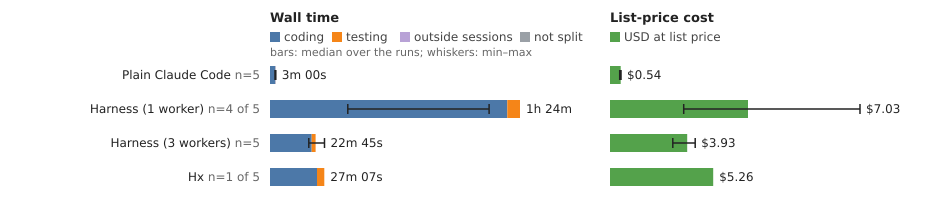

# Benchmark results

The full benchmark log: every table with ranges, the figure, per-arm notes, run settings and definitions. The [README](../README.md#benchmark) shows the short version. Generated by `bench/figures.py` and `bench/crossover.py` from `bench/results/`; do not edit by hand.

<!-- bench:begin — generated by bench/figures.py from bench/results/; do not edit by hand -->

## Benchmark

### Small fixture (`pennywise`)

Generated by `bench/figures.py` from `bench/results/run-20261115/`; re-running it reproduces this section and the figure byte for byte. Costs are list price; `n/a` is a figure the run did not produce.

| Arm | n | Cap status | Wall time | Coding | Testing | Tokens | in / out / cache read / cache write (median) | List price | % of weekly window | Hidden tests passed | Fuzz divergences | Fuzz classes | Blind review (of 10) | Issues / PRs / commits | Continue replies | Models | SonarQube | Coverage (own tests) |
|---|---|---|---|---|---|---|---|---|---|---|---|---|---|---|---|---|---|---|
| Plain Claude Code | n=5 | within caps | 3m 00s (2m 38s–3m 04s) | 2m 52s (2m 33s–2m 56s) | 2s (0s–5s) | 402.2k (341.7k–446.2k) | 22 / 17.3k / 360.4k / 23.4k | $0.54 ($0.50–$0.56) | 1.2% (1.1%–1.2%) | 80 (80–80) / 80 | 9 (5–20) / 1000 | 3 (2–4) | n/a | 1 (1–1) commits | 0 (0–0) | claude-opus-5-5 | bugs 0 (0–0), vulns 0 (0–0), smells 0 (0–1), maint. A, dup 0 (0–0)% | 92.6% (91.2%–96.7%) (line 94% (92.2%–96.9%), branch 88.1% (86.2%–96%)) |
| Harness (1 worker) | n=4 of 5 | 4 within caps, 1 error | 1h 24m (41m 04s–1h 55m) | 2h 05m (1h 03m–3h 05m) | 6m 43s (3m 05s–10m 55s) | 11.3M (5.5M–19.5M) | 681 / 193.0k / 10.2M / 866.9k | $7.03 ($3.76–$12.73) | 15.3% (8.2%–27.7%) | 80 (80–80) / 80 | 0 (0–6) / 1000 | 0 (0–1) | n/a | 19.5 (9–35) issues, 19.5 (9–35) PRs | 0 (0–0) | claude-opus-5-5, claude-sonnet-5-5 | bugs 0 (0–0), vulns 0 (0–0), smells 0 (0–0), maint. A, dup 0 (0–0)% | 98.2% (97.7%–98.8%) (line 98.75% (97.2%–99%), branch 97.4% (95.8%–100%)) |
| Harness (3 workers) | n=5 | within caps | 22m 45s (20m 30s–28m 45s) | 22m 00s (19m 13s–51m 32s) | 2m 03s (1m 39s–5m 20s) | 6.2M (4.4M–6.7M) | 358 / 105.6k / 5.6M / 429.9k | $3.93 ($3.20–$4.34) | 8.2% (7.0%–9.2%) | 80 (80–80) / 80 | 0 (0–0) / 1000 | 0 (0–0) | n/a | 9 (7–12) issues, 9 (7–12) PRs | 0 (0–0) | claude-opus-5-5, claude-sonnet-5-5 | bugs 0 (0–0), vulns 0 (0–0), smells 0 (0–1), maint. A, dup 0 (0–0)% | 98.5% (97.7%–98.8%) (line 99.1% (98.2%–99.3%), branch 96.7% (95.3%–97.6%)) |
| Hx | n=1 of 5 | within caps | 27m 07s | 24m 50s | 3m 51s | 3.8M | 384 / 119.5k / 3.3M / 441.7k | $5.26 | 11.4% | 80 / 80 | 16 / 1000 | 3 | n/a | 6 issues, 6 PRs | n/a | claude-opus-5-5 | bugs 0, vulns 0, smells 0, maint. A, dup 0% | 92.3% (line 94%, branch 83.3%) |
| Harness (all Opus, plain's effort) | n/a | skipped: no-information (operator, owner rule): every small-fixture arm scores 80/80 and the medium fixture shows harness-opus = harness quality (114/114 both), so a small matched-model arm would add cost and no information; not a budget skip. Cancelled at launch by the operator | n/a | n/a | n/a | n/a | n/a | n/a | n/a | n/a | n/a | n/a | n/a | n/a | n/a | n/a | n/a | n/a |

Coding and Testing count time inside agent sessions; the rest of Wall time is time outside them (orchestration, waiting), drawn as its own segment in the figure.

**Runs:** `n` is the number of runs behind an arm's row (`bench/run.py --runs N`). With `n` above 1 a cell shows the median and, in brackets, the range (min–max) over those runs, and the figure draws the median with range whiskers. `n=1` is a single run: agent wall time and cost vary 20–40% between runs, so one run supports no claim.

**Stopped early, Harness (1 worker):** 4 of 5 runs completed (5 started); stopped because operator: run 5 is invalid and not counted: its fleet never started work (every lane launch failed with start_failed for the whole 6 h wall cap, 0 of 80 hidden tests; see its run.log and events.jsonl). The Harness arm is re-benched under PRD #1180, which adds start_failed fail-fast, so no run 5 was repeated on this engine (owner rule: no runs that cannot change a conclusion)

**Stopped early, Hx:** 1 of 5 runs completed (1 started); stopped because operator: ended by hand after run 1 (owner rule: no runs that cannot change a conclusion): the Harness arms are re-benched under PRD #1180, so more Hx runs on this engine commit cannot change a conclusion

**Fuzz divergences:** cases where the arm and the reference implementation disagree, out of the cases run, for the same random argv and ledger files (dash-led arguments and `--`, a byte order mark and invalid UTF-8, LF / CRLF / lone CR line endings and form feeds or U+2028 in a note, stdin or a file, a closed output pipe): on standard output, on whether standard error is empty, on the exit status, or on the ledger `add` leaves behind (`bench/fuzz.py`, seed 620, generator hash `5c7f3fbfa079…`). Up to 10 examples per arm are in its results JSON (`fuzz_examples`).

**Fuzz classes:** the fuzz divergences grouped into distinct root causes, one class per (input feature, what differed) pair (`bench/rootcause.py`); the raw count is dominated by whichever bug the generator reaches most often, the class count is not. The classes of each run are in its results JSON (`fuzz_class_counts`).

**Blind review:** `n/a`: no scripted review (`bench/review.py`) has been run on this run's repos. An unscripted review is not evidence and is not quoted.

**Ship rule:** a fleet change ships only if, over at least 5 runs of it against at least 5 runs of the baseline, (1) the median number of fuzz classes is no higher than the baseline's, (2) no class appears that the baseline never showed, and (3) the blind-review mean has not dropped by more than 0.5. `bench/shiprule.py` applies it to the runs' results JSON; cost and time cuts are judged against these, not assumed.

**Claude config:** the Plain Claude Code arm's sessions ran isolated; its front-door init loaded no skills, plugins or MCP servers.

**Claude config:** the Harness (1 worker) arm's sessions ran on the same isolated Claude config as the plain arm, plus only what the Harness engine installs (19 skills, 0 plugins); its front-door init loaded 38 skills (the CLI's bundled ones included), 0 plugins and 0 MCP servers.

**Claude config:** the Harness (3 workers) arm's sessions ran on the same isolated Claude config as the plain arm, plus only what the Harness engine installs (19 skills, 0 plugins); its front-door init loaded 38 skills (the CLI's bundled ones included), 0 plugins and 0 MCP servers.

**Run settings, Plain Claude Code:** models claude-opus-5-5; effort by message medium (21); asked for model default, effort default; engine commit `879964dc4ae3`; `/harness` skill `sha256:104fcebf3f893ceb`; Claude Code CLI `2.1.325 (Claude Code)`.

**Run settings, Harness (1 worker):** models claude-opus-5-5, claude-sonnet-5-5; effort by message high (263), medium (54); asked for model default, effort default; engine commit `879964dc4ae3`; `/harness` skill `sha256:104fcebf3f893ceb`; Claude Code CLI `2.1.325 (Claude Code)`.

**Run settings, Harness (3 workers):** models claude-opus-5-5, claude-sonnet-5-5; effort by message high (253), medium (56); asked for model default, effort default; engine commit `879964dc4ae3`; `/harness` skill `sha256:104fcebf3f893ceb`; Claude Code CLI `2.1.325 (Claude Code)`.

**Run settings, Hx:** models claude-opus-5-5; effort by message medium (339); asked for n/a; engine commit `879964dc4ae3`; `/harness` skill `sha256:104fcebf3f893ceb`; Claude Code CLI `2.1.325 (Claude Code)`.

### Medium fixture (`medium`)

Generated by `bench/figures.py` from `bench/results/run-20261111-medium/`; re-running it reproduces this section and the figure byte for byte. Costs are list price; `n/a` is a figure the run did not produce.

| Arm | n | Cap status | Wall time | Coding | Testing | Tokens | in / out / cache read / cache write (median) | List price | % of weekly window | Hidden tests passed | Fuzz divergences | Fuzz classes | Blind review (of 10) | Issues / PRs / commits | Continue replies | Models | SonarQube | Coverage (own tests) |
|---|---|---|---|---|---|---|---|---|---|---|---|---|---|---|---|---|---|---|
| Plain Claude Code | n=5 | within caps | 6m 23s (5m 18s–7m 05s) | 6m 08s (4m 55s–6m 50s) | 10s (4s–27s) | 834.5k (730.5k–932.1k) | 30 / 40.6k / 747.6k / 50.7k | $1.20 ($0.96–$1.27) | 2.3% (1.8%–2.4%) | 114 (114–114) / 114 | 0 (0–0) / 1000 | 0 (0–0) | n/a | 1 (1–1) commits | 0 (0–0) | claude-opus-5-5 | bugs 0 (0–0), vulns 0 (0–0), smells 0 (0–1), maint. A, dup 0 (0–0)% | 96.5% (87.5%–97.1%) (line 96.6% (88.9%–97.5%), branch 95.7% (83.8%–96.8%)) |
| Harness (all Opus, plain's effort) | n/a | skipped: not run | n/a | n/a | n/a | n/a | n/a | n/a | n/a | n/a | n/a | n/a | n/a | n/a | n/a | n/a | n/a | n/a |
| Harness (3 workers) | n/a | skipped: not run | n/a | n/a | n/a | n/a | n/a | n/a | n/a | n/a | n/a | n/a | n/a | n/a | n/a | n/a | n/a | n/a |
| Hx | n/a | skipped: not run | n/a | n/a | n/a | n/a | n/a | n/a | n/a | n/a | n/a | n/a | n/a | n/a | n/a | n/a | n/a | n/a |

Coding and Testing count time inside agent sessions; the rest of Wall time is time outside them (orchestration, waiting), drawn as its own segment in the figure.

**Runs:** `n` is the number of runs behind an arm's row (`bench/run.py --runs N`). With `n` above 1 a cell shows the median and, in brackets, the range (min–max) over those runs, and the figure draws the median with range whiskers. `n=1` is a single run: agent wall time and cost vary 20–40% between runs, so one run supports no claim.

**Fuzz divergences:** cases where the arm and the reference implementation disagree, out of the cases run, for the same random argv and ledger files (dash-led arguments and `--`, a byte order mark and invalid UTF-8, LF / CRLF / lone CR line endings and form feeds or U+2028 in a note, stdin or a file, a closed output pipe): on standard output, on whether standard error is empty, on the exit status, or on the ledger `add` leaves behind (`bench/fuzz.py`, seed 621, generator hash `dadc646bc2e0…`). Up to 10 examples per arm are in its results JSON (`fuzz_examples`).

**Fuzz classes:** the fuzz divergences grouped into distinct root causes, one class per (input feature, what differed) pair (`bench/rootcause.py`); the raw count is dominated by whichever bug the generator reaches most often, the class count is not. The classes of each run are in its results JSON (`fuzz_class_counts`).

**Blind review:** `n/a`: no scripted review (`bench/review.py`) has been run on this run's repos. An unscripted review is not evidence and is not quoted.

**Ship rule:** a fleet change ships only if, over at least 5 runs of it against at least 5 runs of the baseline, (1) the median number of fuzz classes is no higher than the baseline's, (2) no class appears that the baseline never showed, and (3) the blind-review mean has not dropped by more than 0.5. `bench/shiprule.py` applies it to the runs' results JSON; cost and time cuts are judged against these, not assumed.

**Claude config:** the Plain Claude Code arm's sessions ran isolated; its front-door init loaded no skills, plugins or MCP servers.

**Run settings, Plain Claude Code:** models claude-opus-5-5; effort by message medium (38); asked for model default, effort default; engine commit `85f72c192b9d-dirty`; `/harness` skill `sha256:064c51f34bfa1028`; Claude Code CLI `2.1.322 (Claude Code)`.

<!-- bench:end -->

<!-- when-to-use:start -->
## When to use Harness

Generated by `bench/crossover.py` from `bench/results/` (small `run-20261110`, medium `run-20261111-medium`). One Claude Code session start to finish against Harness start to finish, no human help for either, at three sizes, median and (range) over the runs. A cell with fewer than 5 runs is marked indicative and supports no claim.

**small** (`pennywise`: 17 criteria, 239 lines, 4 files, 1 subsystem)

| arm | runs | wall time | cost | hidden tests | fuzz classes | blind review /10 | nudges | interventions |
|---|---|---|---|---|---|---|---|---|
| plain | n=5 | 2.9 min (2.3–3.1) | $0.58 (0.44–0.59) | 100% | 3 (1–4) | — | 0 | 0 |
| harness | n=3, indicative | 76.5 min (33.1–91.4) | $8.34 (4.04–9.64) | 100% | 0 | — | 0 | 0 |

**medium** (`medium`: 37 criteria, 629 lines, 13 files, 2 subsystems)

| arm | runs | wall time | cost | hidden tests | fuzz classes | blind review /10 | nudges | interventions |
|---|---|---|---|---|---|---|---|---|
| plain | n=5 | 6.4 min (5.3–7.1) | $1.2 (0.96–1.27) | 100% | 0 | — | 0 | 0 |

**large** (`large`): not run

**Harness against plain**

| size | arm | quality vs plain | time vs plain | cost vs plain | verdict |
|---|---|---|---|---|---|
| small | harness | beats (fuzz classes) | ×26.52 | ×14.4 | indicative (n<5) |

**The crossover.** Quality (Harness matches or beats plain): not reached at a size with 5 runs a side. Time (Harness with 3 workers also matches or beats plain): not reached at a size with 5 runs a side. Indicative only (fewer than 5 runs a side): small. Still to run (not run: large; fewer than 5 runs: small) in #1035.

**The tier thresholds** (`scripts/tier.toml`, read by `harness tier decide`): direct up to 8 criteria, 500 changed lines, 10 files and 1 subsystem; fleet from 16 criteria, 3 subsystems or 2 independent workstreams with a pool of 2. No limit moved: no size has a stated verdict (fewer than 5 runs a side, or not run); estimate.direct_minutes_base 3 -> 0.0, direct_minutes_per_criterion 1.5 -> 0.175 (fitted to 2 measured sizes); estimate.direct_usd_base 0.3 -> 0.05, direct_usd_per_criterion 0.1 -> 0.031 (fitted to 2 measured sizes).
<!-- when-to-use:end -->
